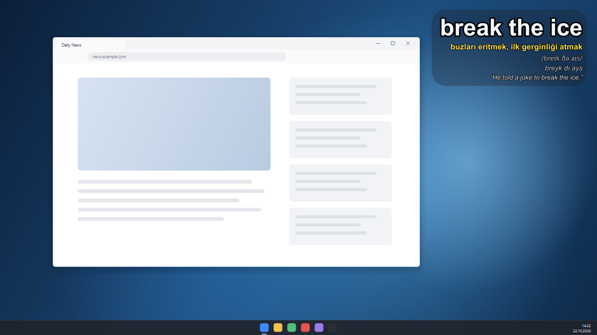
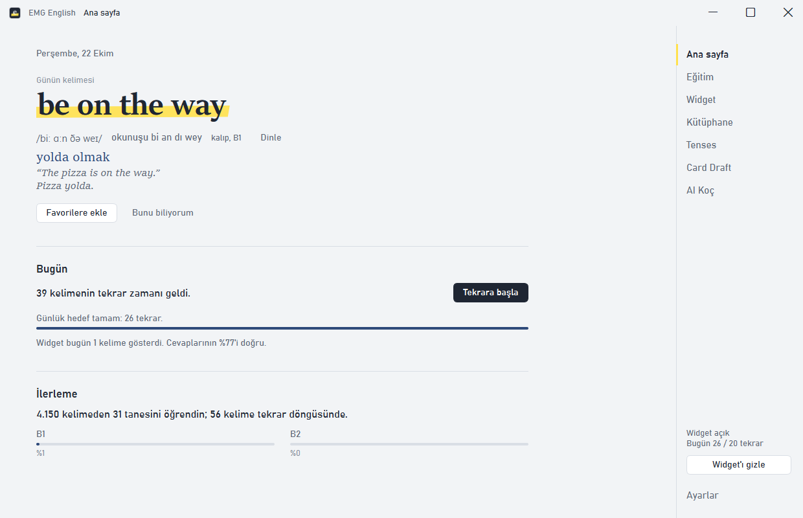
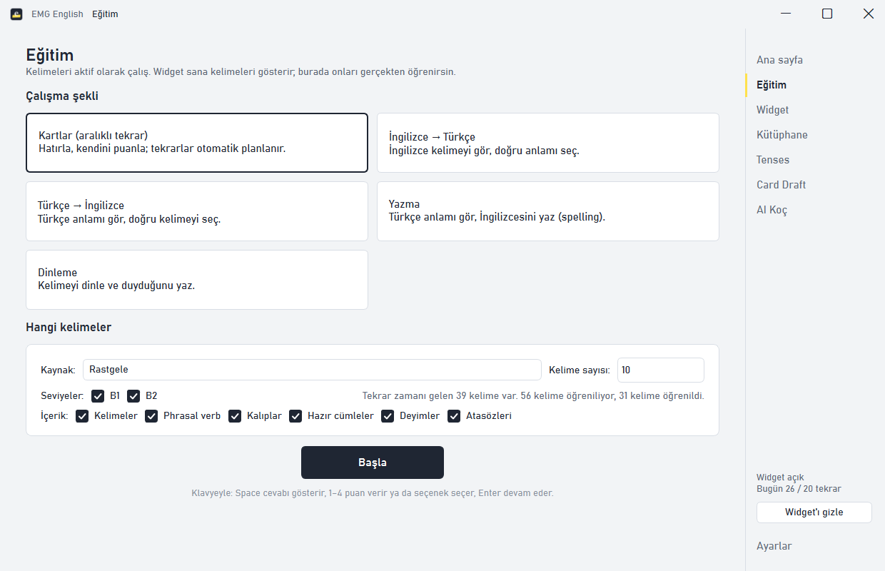
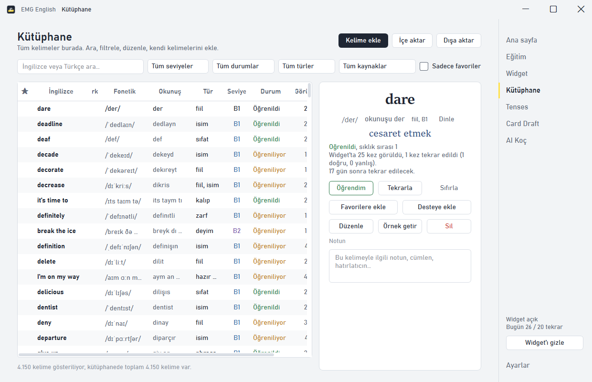
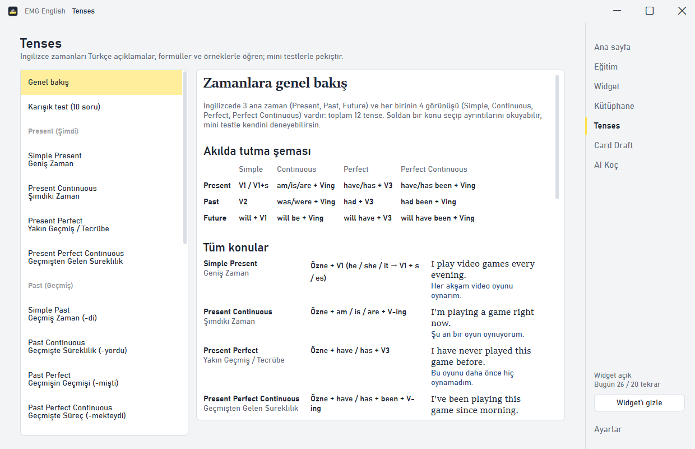
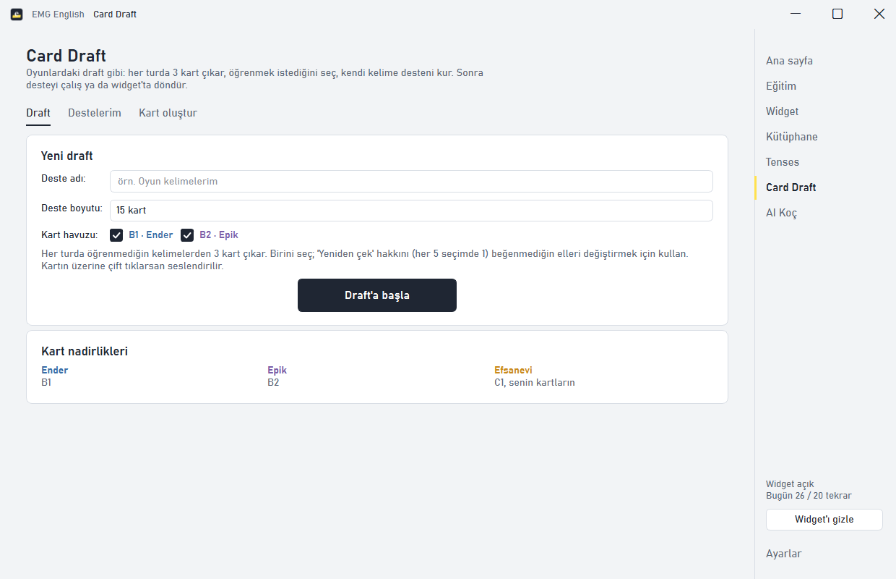
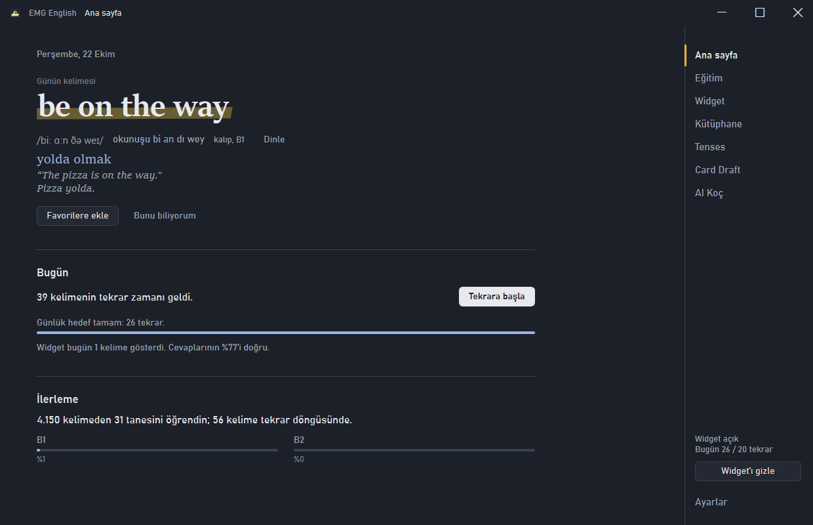

# EMG English — gün boyu İngilizceye maruz kal


Oyun oynarken, çalışırken, internette gezerken ekranın köşesinde sürekli dönen kelimelerle İngilizce
öğren. Widget kelimeleri gösterir; Eğitim sayfası aralıklı tekrar (SRS) ile kalıcı öğrenmeyi sağlar.

> **EN:** A Windows desktop app for Turkish speakers learning English. An always-on-top overlay widget
> cycles through ~4,150 words, phrasal verbs, idioms and proverbs (with Turkish meanings, IPA and Turkish
> pronunciation) while you game or work; a spaced-repetition trainer, tense lessons and an optional AI
> coach help you retain them. Built with Python + PySide6.



## İndir

[**Releases**](https://github.com/sezerD8/emg-english/releases/latest) sayfasından
`EMG-English.exe`'yi indirip çalıştır. Kurulum ya da Python gerekmez (Windows 10/11).

> Uygulama dijital olarak imzalı olmadığı için Windows SmartScreen ilk açılışta uyarı verebilir:
> **Ek bilgi → Yine de çalıştır**.

`EMG-English.exe --minimized` yalnızca widget + sistem tepsisi ile başlatır. Kişisel verilerin (ilerleme,
ayarlar, yedekler) `%APPDATA%\EMGEnglish\` klasöründe tutulur; `.exe`'yi silmek ya da güncellemek
ilerlemene dokunmaz.

## Ekran görüntüleri

| Ana sayfa | Eğitim |
|---|---|
|  |  |
| **Kütüphane** | **Tenses** |
|  |  |
| **Card Draft** | **Gece teması** |
|  |  |

## Sayfalar

- **Ana sayfa** — günün kelimesi, bugün tekrar edilecekler ve günlük hedef, kısa bir ilerleme özeti.
- **Eğitim** — 5 mod: Kartlar (aralıklı tekrar), İngilizce→Türkçe, Türkçe→İngilizce, Yazma, Dinleme.
  Kaynak seçimi: akıllı, sadece tekrarlar, yeni kelimeler, widget'ta en çok gördüklerin, en çok yanıldıkların,
  favoriler, bir deste… Kısayollar: `Space` cevabı göster, `1-4` puan/seçenek, `Enter` devam.
- **Widget** — değişme süresi, kelime kaynağı/sırası, seviyeler, arka plan rengi ve opaklığı, yazı opaklığı,
  her satırın boyutu/rengi, yazı tipi, hizalama, hazır temalar, 9 konum + sürükleyerek özel konum, monitör seçimi,
  aktif hatırlama modu, tense cümlesi karıştırma, otomatik seslendirme, oyun modu. Canlı önizlemeli.
- **Kütüphane** — ~4150 kelime ve ifadenin tamamı; arama, filtre, düzenleme, not, favori, desteye ekleme,
  internetten doldurma (ücretsiz sözlük + çeviri), CSV içe/dışa aktarma.
- **Tenses** — 12 zaman + used to, şart cümleleri, edilgen yapı, modal fiiller. Türkçe açıklama, formül,
  kullanım yerleri, ipucu kelimeler, örnek cümleler, sık hatalar ve her konu için mini test + karışık test.
- **Card Draft** — oyunlardaki draft gibi: her turda 3 kart çıkar (nadirlik = seviye), birini seç, kendi
  desteni kur. Desteyi çalış veya widget'ta döndür. Kendi kartlarını da oluşturabilirsin.
- **AI Koç** (isteğe bağlı) — Türkçe ve İngilizce bilen dil koçuyla sohbet: çeviri, gramer, kelime, telaffuz
  soruları, hata düzeltme, rol yapma ve konuşma pratiği. Ayrıntılar: [AI Koç](#ai-koç).
- **Ayarlar** — adın, günlük hedef, Windows ile başlat, tepsiye küçült, ses ve konuşma hızı, okunuş yazım
  tarzı (w / v, th / t), Gündüz / Gece teması, yedekleme–geri yükleme, ilerlemeyi sıfırlama.

## Widget

5 satır: **İngilizce kelime → Türkçe anlamı → fonetik (IPA) → Türkçe okunuşu → örnek cümle**. Widget →
*İçerik* ile hangi türlerin döneceği seçilir. Arka planı şeffaf, her pencerenin ve oyunun üstünde durur,
görev çubuğunda görünmez.

- Sürükle → taşı • Sağ tık → menü • Çift tık → seslendir • Fare üzerindeyken kelime değişmez
- **Oyun modu**: tıklamalar widget'ın içinden geçer, oyunu engellemez.

### Tam ekran oyunlar

Widget ön plandaki uygulamayı izler:

- **Borderless / pencereli tam ekran** (ve F11 video vb.): widget oyunun üstünde tutulur; saniyede 4 kez
  yenilenir, böylece kendini öne iten oyunlarda da üstte kalır.
- **Exclusive (özel) tam ekran**: Windows bu modda hiçbir pencerenin oyunun üstüne çizilmesine izin vermez
  (Discord/Steam overlay'leri bunu oyunun içine kod enjekte ederek yapar; bu, hile korumalı oyunlarda ban
  riski taşıdığı için yapılmadı). Bu modda kelime ve Türkçe anlamı **sesli okunur**. Görsel widget
  istiyorsan oyunun görüntü ayarından *Borderless / Pencereli tam ekran*'ı seç.
- Davranış Widget → *Tam ekran ve oyunlar* bölümünden seçilir.

### Global kısayollar (oyun içindeyken de çalışır)

| Kısayol | Eylem |
|---|---|
| `Ctrl+Alt+→` / `Ctrl+Alt+←` | Sonraki / önceki kelime |
| `Ctrl+Alt+H` | Widget'ı gizle / göster |
| `Ctrl+Alt+P` | Duraklat / devam |
| `Ctrl+Alt+L` | Bu kelimeyi öğrendim |
| `Ctrl+Alt+F` | Favori |
| `Ctrl+Alt+S` | Seslendir |
| `Ctrl+Alt+R` | Anlamı göster (aktif hatırlama) |
| `Ctrl+Alt+C` | Oyun modunu aç / kapat |

## Öğrenme mantığı

- A1–A2 (en sık 2000 temel kelime: the, you, I…) listede yok; arşivi `app/data/words_archive/` klasöründe.
  Kalan kelimeler sıklık sırasına göre B1 (ilk 1500) ve B2 (sonrası) olur. Kendi eklediklerin C1 olur.
- Tek kelimelerin yanında **phrasal verb**, **kalıp** (*it's no use doing something*), **hazır cümle**
  (*I'm on my way*), **deyim** (*break the ice*) ve **atasözü** (*better late than never*) da var. Her birinde
  Türkçe karşılık ve çevirili örnek cümle bulunur. Bu türler kelimelerin arasına eşit aralıklarla serpiştirilir.
- **Akıllı widget**: öğrenmekte olduğun kelimeleri daha sık, sıradaki yeni kelimeleri (en az görülenler önce) ve
  ara sıra öğrendiklerini gösterir. Widget'ta sık gördüğün yeni kelimeler Eğitim'de öncelikli gelir.
- **Aralıklı tekrar (SM-2 benzeri)**: her doğru cevap bir sonraki tekrarı ileri atar (1 gün → 3 gün → …).
  Zamanında yapılan **4 başarılı tekrar** sonrası kelime "öğrenildi" olur. Yanlış cevap kelimeyi sıfırlar ve
  10 dk sonra tekrar sorar.

## AI Koç

Koç, bilgisayarında kurulu [Claude Code](https://claude.com/claude-code)'u arka planda dil koçu olarak
çalıştırır. **API anahtarı gerekmez**: Claude Code'da giriş yaptığın hesap kullanılır, EMG English hesap
bilgilerini görmez ve saklamaz.

Ajanın hiçbir aracı yoktur (dosya okuyamaz, komut çalıştıramaz), sadece sohbet eder. Cevaplar ilerleme
verine göre (zorlandığın kelimeler vb.) kişiselleşir. Sohbet saklanır, uygulama kapanıp açılınca kaldığı
yerden devam eder. Model seçilebilir (Opus / Sonnet / Haiku).

Gereksinim: Claude Code kurulu ve bir terminalde `claude` yazılarak giriş yapılmış olmalı.
**Claude Code yoksa sadece AI Koç sayfası çalışmaz**, uygulamanın geri kalanı normal kullanılır.

## Veri

Her şey `%APPDATA%\EMGEnglish\emg.db` (SQLite) dosyasında saklanır: kelimeler, her kelimenin ilerlemesi,
ayarlar, günlük istatistikler, cevap geçmişi, desteler, tense skorları. Yedekler aynı klasördeki `backups\`
içine alınır. Hata olursa ayrıntı `error.log` dosyasına yazılır.

## Kaynaktan çalıştırma

Gereksinim: [Python 3.10+](https://www.python.org/downloads/).

```powershell
git clone https://github.com/sezerD8/emg-english.git
cd emg-english
python -m venv .venv
.venv\Scripts\activate
pip install -r requirements.txt
python main.py
```

### .exe derleme

```powershell
pip install pyinstaller
pyinstaller emg-english.spec      # → dist\EMG-English.exe
```

`v1.2.0` gibi bir etiket gönderildiğinde (`git tag v1.2.0 && git push origin v1.2.0`) GitHub Actions
`.exe`'yi kendisi derleyip Releases'a yükler (`.github/workflows/release.yml`). İkon tasarımı değişirse
`python tools/make_icon.py` ile `assets/emg.ico` yeniden üretilir (Pillow gerekir).

## Kelime listesi biçimi

Gömülü kelimeler `app/data/words/*.txt` dosyalarındadır, her satır bir kayıt:

```
ingilizce|tür|türkçe|ipa|örnek|örnek türkçe
```

Son iki alan isteğe bağlı; satır sırası = sıklık sırası. `#! level=B1` satırı o dosyanın seviyesini belirler.
Kalıp/deyim dosyaları `phrases_*.txt`, tür kodları: `phr` phrasal verb, `pat` kalıp, `expr` hazır cümle,
`idiom` deyim, `prov` atasözü. Liste değişince `config.DATA_VERSION` artırılır; açılışta veritabanı listeyle
eşitlenir (listeden çıkarılan gömülü kelimeler silinir, öncesinde otomatik yedek alınır). Türkçe okunuşlar
IPA'dan otomatik üretilir; kelime düzenleme penceresinden elle değiştirilebilir.

CSV içe aktarma biçimi (başlık satırı isteğe bağlı): `english;turkish;phonetic;pos;example;example_tr`

## Proje yapısı

```
main.py                 giriş noktası (tek kopya, tepsi, kısayollar)
app/database.py         SQLite şeması ve tüm veri işlemleri, SRS
app/overlay.py          masaüstü widget'ı
app/widget_render.py    widget çizimi (widget + önizleme ortak)
app/pronunciation.py    IPA → Türkçe okunuş
app/hotkeys.py          global kısayollar (RegisterHotKey)
app/winutil.py          Win32: üstte tutma, tam ekran algılama, özel pencere çerçevesi
app/tts.py              seslendirme (WinRT / SAPI)
app/online.py           dictionaryapi.dev + MyMemory
app/ai_coach.py         AI Koç ajanı (Claude Code süreci, sistem istemi, öğrenci profili)
app/ui/*.py             sayfalar ve başlık çubuğu
app/data/tenses.py      tense içerikleri ve testleri
app/data/words/*.txt    gömülü kelime ve ifade listeleri
app/data/words_archive/ çıkarılan A1–A2 kelimeleri (yüklenmez)
emg-english.spec        PyInstaller derleme tanımı (tek dosyalık .exe)
assets/emg.ico          .exe ikonu (tools/make_icon.py üretir)
.github/workflows/      etiket gönderilince .exe'yi derleyip Releases'a yükler
```

## Katkı

Hata bildirimi, öneri ve pull request'ler memnuniyetle karşılanır. Özellikle kelime listesindeki
çeviri / IPA / örnek cümle düzeltmeleri çok değerli: `app/data/words/*.txt` dosyalarını düzenleyip
`config.DATA_VERSION`'ı bir artırman yeterli. Büyük değişikliklerden önce bir issue açarak konuşalım.

## Lisans

[MIT](LICENSE)
